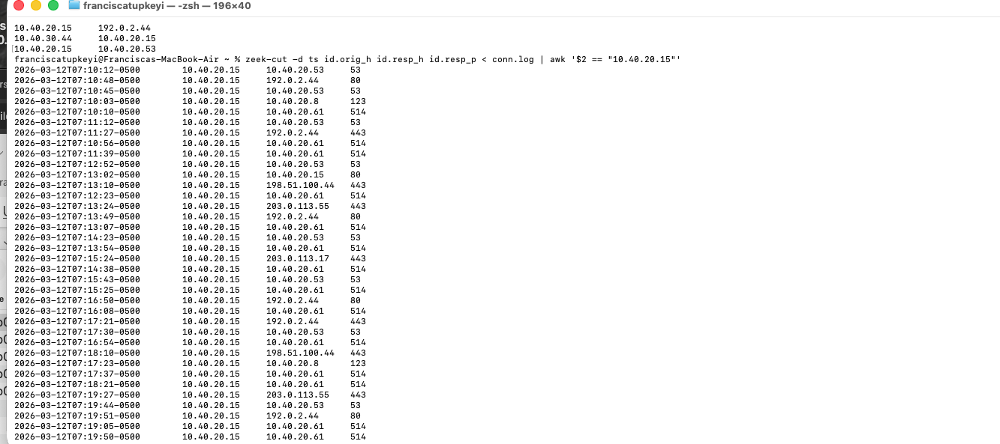
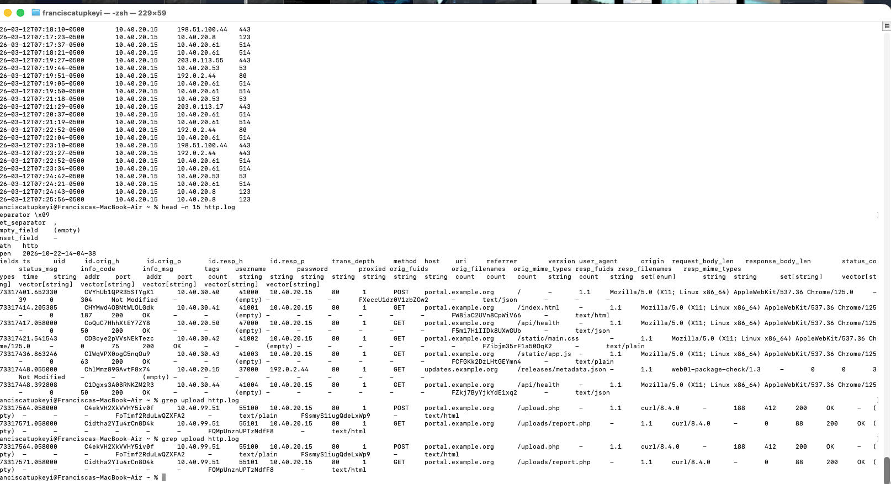
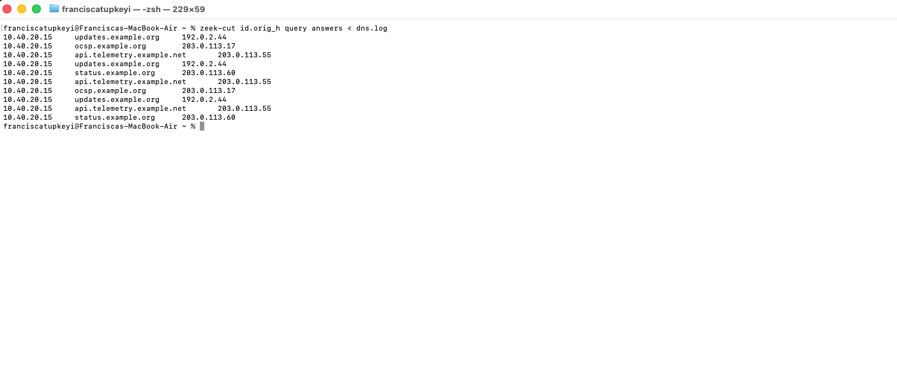
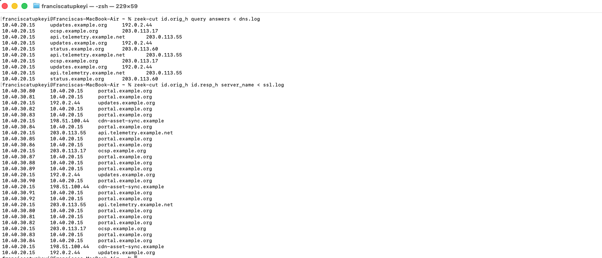
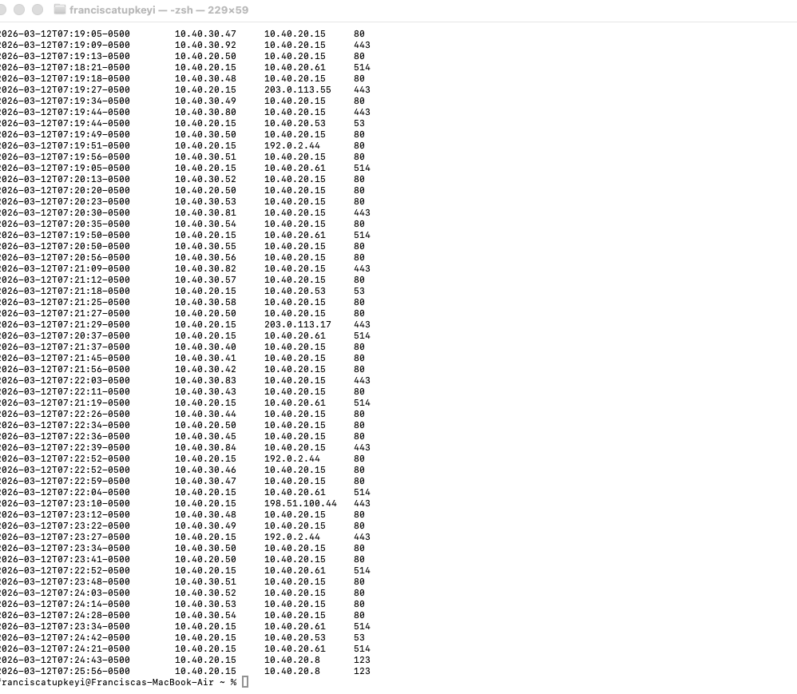

# Web01 SOC Investigation

**Network traffic analysis and incident scoping with Wireshark and Zeek**  
Analyst: Francisca Tupkeyi

## Project overview

In this synthetic classroom investigation, I examined unusual outbound traffic from a production web server called **web01**. I correlated a PCAP with web access logs and Zeek connection, DNS and TLS records to reconstruct the timeline and assess the scope of a possible compromise.

[Read my incident analysis](report/Web01_Incident_Analysis.pdf)

## Tools and skills

* Wireshark: packet inspection, TCP connection initiation and TLS metadata.
* Zeek: connection, HTTP, DNS and TLS log analysis.
* Terminal: filtering log fields with `zeek-cut`.
* SOC analysis: timeline reconstruction, evidence correlation and distinguishing observed facts from hypotheses.

## Findings

* **10.40.20.15 (web01)** initiated three connections to **198.51.100.44:443**, five minutes apart.
* **10.40.99.51** sent `POST /upload.php`, then `GET /uploads/report.php`. Both received HTTP 200 responses.
* The first recurring external connection began 19 seconds after the PHP request.
* The TLS ClientHello included **cdn-asset-sync.example**. No matching DNS lookup appeared in the capture.
* Internal DNS, syslog and time synchronization traffic continued. The evidence did not establish lateral movement.

The sequence supports investigating possible web shell activity and command-and-control beaconing. It does not confirm a reverse shell, successful malicious code execution or data exfiltration. HTTP 200 responses and regular timing alone do not prove compromise.

## Timeline

Incident date: **March 12, 2026**. Times below use **UTC-05:00**, matching my Zeek display. Add one hour to compare with access logs recorded in UTC-04:00. These offsets represent the same instants.

| Time UTC-05:00 | Event | Packet evidence |
|---|---|---|
| 07:12:44 | POST /upload.php from 10.40.99.51 | Request 329 |
| 07:12:51 | GET /uploads/report.php from the same host | Request 340 |
| 07:13:10 | First connection to 198.51.100.44:443 | Initial SYN 384 |
| 07:18:10 | Second connection | Initial SYN 1003 |
| 07:23:10 | Third connection | Initial SYN 1574 |

The exact alert-generation timestamp was not supplied. The first suspicious connection is the reference point.

## Evidence walkthrough

### Connection pattern

The originator is web01. The connections recur every 300 seconds. Each session contains 612 bytes of outbound TCP payload and 924 bytes inbound; these include TLS traffic and do not establish stolen-data volume.



### HTTP sequence

The POST and subsequent PHP request precede the recurring external sessions. Their timing supports correlation, while host evidence would be needed to confirm causation or code execution.



### DNS and TLS correlation

Background domains included updates.example.org, api.telemetry.example.net and ocsp.example.org. The recurring destination used cdn-asset-sync.example in TLS metadata. A missing captured lookup could reflect caching or resolution before capture.





### Internal scope

web01 contacted 10.40.20.61 on UDP 514, 10.40.20.53 on UDP 53 and 10.40.20.8 on UDP 123. These are consistent with logging, DNS and time synchronization. Similar logging activity also appears before the suspicious sequence.



## Reproduce the review

Run Zeek from a dedicated analysis directory, using the PCAP path appropriate to your computer:

```bash
zeek -C -r /path/to/web01_2026-03-12_correlated.pcap
zeek-cut id.orig_h id.resp_h id.resp_p < conn.log
zeek-cut id.orig_h query answers < dns.log
zeek-cut id.orig_h id.resp_h server_name < ssl.log
zeek-cut id.orig_h method uri status_code < http.log
```

`-C` disables checksum validation for offline analysis. Zeek creates logs in the current directory. Generated Zeek logs are not included here; they can be regenerated from the supplied PCAP.

Wireshark filters:

```wireshark
ip.src == 10.40.20.15 && ip.dst == 198.51.100.44 && tcp.flags.syn == 1 && tcp.flags.ack == 0
http.request && ip.src == 10.40.99.51
dns || tls.handshake.type == 1
```

## Next investigative steps

Inspect report.php and upload handling. Correlate PHP and endpoint logs with process-to-network activity. Investigate 10.40.99.51 and verify whether the external destination and internal services are authorized. Review a wider time window for persistence and other affected hosts.

## Dataset context

The supplied correlation guide identifies this PCAP and supporting logs as synthetic classroom material. The external IPs are documentation addresses and the domains are examples. They are not live threat indicators. The guide describes how the March-dated capture was reconstructed; the error log contains simulated diagnostics.

## Files

* `report/`: incident report with screenshots.
* `screenshots/`: selected original investigation screenshots with portable filenames.
* `evidence/`: supplied synthetic PCAP, access/error logs and correlation guide.

## What I learned

I practiced connecting web requests with later network behavior, using packet direction to identify a connection initiator, comparing DNS with TLS metadata and documenting uncertainty. I also learned to distinguish internal infrastructure traffic from evidence of lateral movement.
